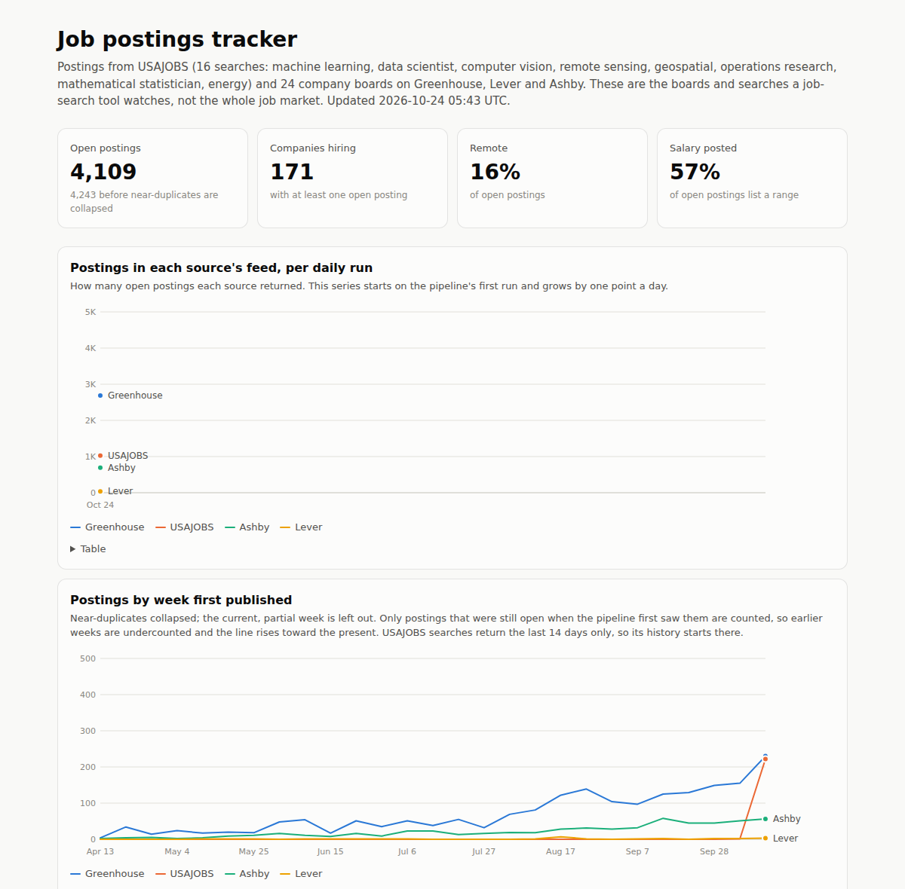

# jobradar

[](https://github.com/CameronGordonn/jobradar/actions/workflows/tests.yml)
[](https://github.com/CameronGordonn/jobradar/actions/workflows/daily.yml)
[](LICENSE)

A job-search pipeline I built with Claude Code and run every morning in my own search. It pulls about 5,600 postings a day from USAJOBS and 64 company job boards, ranks them against my resumes with the Claude API, and loads the same postings into a tested dbt warehouse that feeds a public dashboard.

**[Live dashboard](https://camerongordonn.github.io/jobradar/)** · [Evaluation results](results/eval_summary.md) · [dbt docs](https://camerongordonn.github.io/jobradar/dbt/)

## At a glance

| Area | What the project shows |
|---|---|
| **Data engineering** | Daily ELT on GitHub Actions. Raw API payloads land in DuckDB; dbt builds staging, intermediate, and mart models with tests, source freshness, unit tests, and a snapshot of every version of each posting. A row-count monitor opens a GitHub issue when a source breaks. The warehouse carries over between runs as an Actions artifact, backed up weekly as Parquet in a GitHub Release. |
| **ML evaluation** | 200 blind hand labels from a stratified sample drawn once. Six rankers and two controls compared with bootstrap confidence intervals, paired differences, cost per run, and score stability. The embedding model and the dedupe acceptance rule were fixed before seeing results, and the one rule found after looking at data was checked on fresh samples before it shipped. |
| **LLM application** | Claude API with structured output through a tool call, a cached system prompt, the Batch API for evaluation at half price, a per-run spending cap, and cost measured from token counts. |
| **Software** | Python adapters for four job APIs, an offline pytest suite, ruff and sqlfluff in CI, and a local web app for tracking applications. |

### Results

| Question | Answer |
|---|---|
| Does the Claude rerank beat keyword matching? | Yes. ROC AUC on postings I'd apply to is 0.92 to 0.96 for the three Claude models against 0.67 for TF-IDF. The paired differences are +0.25 to +0.29, and every 95% CI clears zero (the lowest bound is +0.08). Precision@10 points the same way (0.61 to 0.73 against 0.20) but its intervals run from about 0.3 to 1.0. |
| Is that just because only Claude sees the rubric? | Not explained by the candidate description. Given the rubric's candidate section as one more query, each compared with itself without it, TF-IDF moves 0.672 to 0.677 (+0.005, CI -0.045 to +0.088) and bge-small 0.676 to 0.658 (-0.017). The rubric query is the best match for 20% of postings, so it gets a real say. This can't test the rubric's judging rules (dealbreakers, how to read seniority), which a retrieval model can't apply. The report checks from the databases that all 750 Claude eval scores predate the first label. The caveat that remains: I wrote the rubric and made the labels, so Claude is scored on following my own stated preferences, which is the job of a personal ranker but not an independent judgment. |
| Which model? | Haiku 5.5, accepting a possible small loss in quality. With 12 positive labels the three models can't be separated, but Haiku 5.5 has the lowest point estimates and the least exact repeatability: rescoring the same 50 postings gave the same score 58% of the time (Sonnet 5.5: 94%), though always within one point. It costs $0.0010 per posting against $0.0135 for Sonnet 5.5, so about $0.03 on a median day of 34 new postings. |
| Where does the pipeline lose good jobs? | Downtime, not ranking. As of Oct 25, 10 of the 12 "apply" postings have been scored, and the other 2 closed during the three weeks before the daily run was scheduled, when it ran only by hand and not at all from Sep 29 to Oct 20. The 10 waited a median of 24 days from first seen to scored, for the same reason plus a 40-per-run cap working through the backlog. TF-IDF ordering barely tracks good jobs (ranked as one batch it puts 9 of 12 below the top 100), so the queue now goes oldest first, with recall only breaking ties, and the tracker shows a banner when the daily run hasn't loaded anything in 36 hours. A median day brings 34 new postings that pass the filters, under the cap of `recall.top_k` (100 in my config, 40 in the example), so normally everything is scored the day it appears. Scoring the whole 551-posting pool would cost about $0.55. |
| Do the hard filters throw away good jobs? | No loss detected, but the test is weak. None of 30 sampled rejections were jobs I'd apply to or consider. If rejected postings were as good as kept ones (6% apply), that would still happen 16% of the time, and the labels allow up to about 10% of rejections being worth applying to. |
| How are duplicate postings handled? | An embedding-similarity threshold failed its pre-set acceptance rule, catching 3 of 16 marked duplicates. A same-company, same-title rule then matched 30 of 30 fresh hand-checked pairs and collapses 19% of open postings. Those marks were made from titles and locations, and the descriptions of some merged pairs differ (several are translations), so a few merges may join different teams. The rule affects dashboard counts only; ranking and the tracker treat postings as duplicates only with the same company, title, and location. |
| What did the evaluation cost? | $2.30 in API calls. |

The engineering lesson so far: the losses came from operations (no scheduled run for three weeks, then a backlog cap), not from the ranking model. The main caveats: one person labeled everything, two thirds of the labeled postings come from five large employers, and the relabeling round that measures my own consistency opens Oct 31.

**Stack:** Python, SQL, DuckDB, dbt, GitHub Actions, GitHub Pages, Claude API (Anthropic SDK), scikit-learn, sentence-transformers, and pytest.

**Where to look in the code:**
- [jobradar/rerank.py](jobradar/rerank.py): the Claude stage (prompt, tool schema, and cost accounting)
- [jobradar/evaluation.py](jobradar/evaluation.py) and [jobradar/report.py](jobradar/report.py): scoring and metrics for the evaluation
- [warehouse/models/](warehouse/models/): dbt models and tests
- [.github/workflows/daily.yml](.github/workflows/daily.yml): the scheduled pipeline
- [jobradar/tracker.py](jobradar/tracker.py): the application tracker



## How it works

```
                     sources.yaml (public)                         config.yaml + rubric + resumes (personal, gitignored)
                            |                                                       |
USAJOBS  Greenhouse  Lever  Ashby                                                   |
   \         |         |    /                                                       |
    raw_<source> tables in DuckDB (payload as returned, upserted on source job id)  |
        |                                         |                                 |
        |  public warehouse (GitHub Actions)      |  personal ranking (local, daily)|
        v                                         v                                 v
  quality checks -> dbt: staging -> int_jobs -> marts      stage 0: hard filters -> stage 1: TF-IDF (tie-break)
                        (tests, freshness,     |           -> stage 2: Claude rerank (top k) -> digest, tracker
                         unit tests)           |
                 dedupe (company + title) -----+
                                               v
                                   dashboard on GitHub Pages
```

The public half needs only `sources.yaml` and never touches the personal half. Labels, resumes, the rubric, scores, and application history stay on my machine.

## Ranking pipeline

| Stage | What it does |
|---|---|
| 0. Hard filters | Title words (senior, staff, intern, and non-technical sales titles such as Account Executive), employer (military departments), location allow and block lists, the source's country field, clearance wording, minimum years of experience, and USAJOBS hiring path and GS grade. Biased toward keeping postings. |
| 1. Recall | TF-IDF (words and word pairs) cosine against each resume variant, best match kept. It only breaks ties now: each run sends up to `recall.top_k` unscored postings still on their boards (40 in the example config), oldest first, and the rest wait for later runs. A posting counts as closed when it is more than 2 days behind its own source's latest load. |
| 2. Rerank | Claude reads the posting against the rubric and resumes and returns a 0-10 fit score, a recommendation, gaps, and an opening line through a tool call. One posting per call. The rubric and resumes are a cached system prompt. |
| Digest | The top 10 new postings above the fit threshold, as markdown. |
| Tracker | A local page over the same database: an inbox of scored postings still open, the application pipeline, and weekly reply rates. |

## Evaluation

The labels are blind and drawn once, so the metrics measure the pipeline rather than flatter it:

- **Set a**: 200 postings that passed stage 0, 20 from each stage 1 recall decile. The deciles are equal-sized, so set a is close to a uniform sample of everything stage 0 keeps.
- **Set b**: 30 postings stage 0 dropped, stratified by rule, to find filter false negatives.
- **Set c**: 40 postings from set a, relabeled at least 7 days after set a is done. Agreement with my own earlier labels is the ceiling for any ranker.

The labeling screen shows title, company, location, an excerpt, and the link, and hides every score, rank, and filter reason. Labels are apply, maybe, or no.

Rankers compared on the same labeled postings: TF-IDF (stage 1 as it ran), local embeddings (bge-small-en-v1.5, chosen before seeing results for its 512-token window; all-MiniLM-L6-v2 for reference), and the Claude rerank with Haiku 4.5, Haiku 5.5, and Sonnet 5.5. Metrics: ROC AUC, average precision, and precision@10 and @20, with percentile bootstrap CIs over 2,000 resamples of postings, plus paired differences against TF-IDF. The report also covers cost per daily run from measured token counts, score stability when the same 50 postings are scored twice, the stage 0 and top-k audits, and self-agreement.

```bash
python -m jobradar.cli label-sample                 # once
python -m jobradar.cli label --set a,b              # blind labeling
python -m jobradar.cli eval-embed --rubric-control  # local embedding scores and the rubric control (pip install -r requirements-eval.txt)
python -m jobradar.cli eval-score --model claude-haiku-5-5 --run 1          # prints a cost estimate
python -m jobradar.cli eval-score --model claude-haiku-5-5 --run 1 --yes    # spends, within the eval budget
python -m jobradar.cli eval --report                # results/eval_summary.md, eval_metrics.json, precision_at_k.png
```

The `eval` section of `config.yaml` can pin the resumes and rubric the evaluation ran with, so changing the production ones later doesn't change what a rerun measures. Claude scoring goes through the Batch API at half price, and `eval-score` refuses to pass a $5 eval budget unless told to. Anything that pairs a posting with a label is written to a gitignored file, and a test checks that no labeled posting title reaches `results/`.

## Data pipeline

`python -m jobradar.pipeline` needs only `sources.yaml`, so it runs unattended.

- **Ingest**: one raw table per source with the API payload, `first_ingested_at`, and `ingested_at`. Loads upsert on the source job id, so a rerun never adds rows. Every run logs rows fetched and new per source to `ingest_runs`.
- **dbt** (`warehouse/`):
  - staging: one model per source, normalized to a shared schema (title, company, location, URL, workplace type, dates, and salary with currency and interval).
  - intermediate: `int_jobs` with a cleaned and normalized title, role family (regex rules in a seed), remote flag, posted date, yearly salary, open status, and a dedupe cluster.
  - snapshot: `snap_postings` keeps every version of each posting (title, location, salary, remote, and open status), since the raw tables keep only the latest payload.
  - marts: open postings with near-duplicates collapsed, daily postings per source, weekly postings by role family and company, per-run source health, closed postings with days listed, and per-posting edit counts from the snapshot.
  - tests: unique and not_null keys, accepted_values on every enum, relationships from the marts and clusters back to `int_jobs`, singular tests, unit tests on `int_jobs` and the lifecycle mart, and source freshness (warn at 30 hours, error at 54). A pytest builds twice around a run with known edits and checks the snapshot counts exactly those.
  - docs: `dbt docs generate --static` is published next to the dashboard at `/dbt/` (models, columns, tests, and lineage).
- **Data quality**: each run compares every source's row count with the median of its previous 7 runs and flags a drop below half, which usually means an API change. It also flags the run where a configured board goes from postings to none, which a source's total hides (a company that moved to another job board); a board that stays empty is logged, not flagged again. Flags go to `quality_checks`, show as warnings on the Actions run, and open (or comment on) a GitHub issue labeled `data-quality`. Source-level flags also appear on the dashboard.
- **Near-duplicates**: the same role listed for several cities is one job. The rule is same company and same title, ignoring case and punctuation, in any location. It replaced an embedding-similarity threshold after hand marks: on 50 pairs drawn across the similarity range, the pre-set rule for the threshold caught 3 of 16 duplicates, because a different city lowers similarity more than a different role does. The title rule caught 12 of 16 with no false merges, then 30 of 30 fresh pairs it merges were marked the same job (precision at least 0.90, 95% one-sided). It collapses 19% of open postings, against 3.2% for exact matches. `python -m jobradar.pipeline dedupe-eval --rule company_title --pairs <files>` reproduces it; results are in `results/dedupe_title_rule.json` and `results/dedupe_eval.json`.
- **Schedule** (`.github/workflows/daily.yml`, daily at 14:17 UTC): restore the warehouse, ingest, run quality checks and alerts, check freshness, build dbt, dedupe, build the marts, publish the dashboard and dbt docs to Pages, and write a weekly Parquet backup. No Claude calls.
- **CI** (`.github/workflows/tests.yml`, every push): ruff and sqlfluff; pytest; and dbt build, freshness, docs, and the two-build snapshot test against a committed synthetic fixture (eight daily runs of made-up companies, with a simulated outage the quality monitor must catch).

**Where the warehouse lives between runs.** The DuckDB file (about 16 MB) is uploaded as an Actions artifact at the end of each run and downloaded at the start of the next. Artifacts are kept 90 days, the maximum for a public repository. An Actions cache would be simpler to restore but is evicted after 7 days without use and can go sooner when the repository's 10 GB cache fills, so one quiet week would lose everything. As a second copy, once a week the job publishes the raw tables, run logs, clusters, and snapshot history as Parquet in a GitHub Release (about 7 MB). Releases don't expire, so if the artifact is ever gone the next run restores from the latest release and loses at most a week. With neither available, the job stops rather than start over from an empty file. GitHub also pauses scheduled workflows in a public repository after 60 days without commits; re-enabling it brings the chain back from the artifact or the latest release.

## Setup (ranking pipeline)

```bash
python3 -m venv .venv && .venv/bin/pip install -r requirements.txt
cp .env.example .env && chmod 600 .env   # ANTHROPIC_API_KEY, USAJOBS_API_KEY, USAJOBS_EMAIL
cp config.example.yaml config.yaml       # personal filters and resume list (gitignored)
cp rubric.example.md rubric.md           # fill in the candidate section (gitignored)
python -m jobradar.cli run               # ingest -> score -> digest; writes digests/YYYY-MM-DD.md
```

Resumes go in `resumes/` as plain text or as the HTML you print to PDF (read as text, with email and phone numbers removed). Boards go in `sources.yaml`; check a token first with `python -m jobradar.cli probe greenhouse|lever|ashby <token>`. `scripts/daily_run.sh` runs the pipeline from cron or Windows Task Scheduler (through WSL), appends to `data/run.log`, refuses to overlap a running job, and exits non-zero if scoring fails. Claude spend is capped at `recall.top_k` calls per run.

### Job-hunt tracker

`python -m jobradar.cli tracker` serves a page at http://127.0.0.1:8765 from the personal database. It binds to localhost only and opens the database per request, so the daily run can still take the write lock.

- **Inbox:** scored postings that are still open and haven't been acted on, best fit first. Each shows why it fits, the gaps and dealbreakers, the resume variant to use, the model's opening line (check it against the resume before using it), and the full posting. Filter by area (the `area` tag on each board in `sources.yaml`; USAJOBS and hand-added roles are tagged from their titles), fit, and text. Save, Applied, or Not for me (with an optional reason) moves a posting out, along with its duplicates.
- **Pipeline:** Saved, Applied, Interviewing, and Offer columns, with notes. It flags applications with no change in 7 days and postings that have dropped off their board. Roles that came through a person can be added by hand; they are never sent to Claude.
- **Referrals:** `tracker.referrals` in `config.yaml` maps a company to a contact, shown on every posting from that company.
- **Stats:** applications by week, reply and interview rates, median wait for a reply, and the same rates by area and by resume variant.
- **Health:** a banner when the daily run hasn't loaded postings in 36 hours. The public pipeline has its own monitor; the ranking runs from a local scheduler, and three weeks without a run are what lost two good postings.

Status changes are kept in `applications` and `application_events`, so they can later serve as labels for the ranker.

To build the warehouse locally: `pip install -r requirements-pipeline.txt`, then `python -m jobradar.pipeline ingest`, `cd warehouse && dbt build --profiles-dir .`, and `python -m jobradar.pipeline dashboard`.

## Tests

`python -m pytest -q` runs offline on recorded and synthetic fixtures: adapters, filters, idempotent raw loads, the SQLite and key migrations, one Claude call per duplicate group, label sampling and blindness, the relabel lock, metrics (checked against brute force over tie orders), the eval report's privacy, the quality monitor, dedupe, Parquet backup and restore, the dashboard export, and the tracker. With dbt installed it also builds the warehouse twice to test the snapshot. `cd warehouse && dbt build` runs the warehouse tests; `ruff check .` and `sqlfluff lint models tests` (in `warehouse/`) run the linters.

## Known limitations

- The dashboard covers the queries in `sources.yaml` and 64 hand-picked boards, not the job market.
- "Postings by week first published" only sees postings that were still open at the first ingest, so earlier weeks are undercounted until the pipeline has run for a while. "Days listed" has the opposite bias early on: long-listed postings are more likely to be caught, so early medians run high.
- USAJOBS searches return the last 14 days of announcements, and USAJOBS dates have no time zone (US Eastern, stored as given).
- Role families come from title rules. About 8% of open postings match no rule and count as "other".
- TF-IDF weights shift as the corpus grows, so recall scores aren't comparable across weeks. The eval uses scores frozen when the label sets were drawn.
- Both embedding models truncate long postings (512 and 256 tokens).
- One labeler. The eval measures how well the rankers match one person's judgment, bounded by that person's consistency.

## License

MIT. See [LICENSE](LICENSE).
