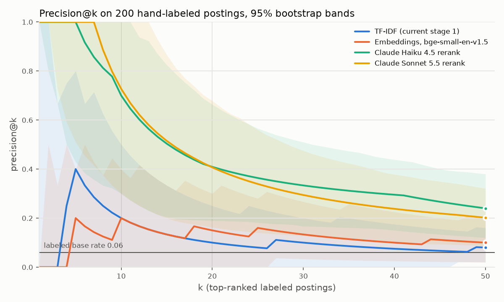

# Ranking evaluation

Generated by `python -m jobradar.cli eval --report` on 2026-10-25. Every number below comes from that command; "pending" means the data for it doesn't exist yet.

## Data

- Postings that passed stage 0 when the label sets were drawn: 551 (snapshot 2026-10-24, seed 20261023).
- Set a: 200 of them, 20 from each stage 1 recall decile. Because the deciles are equal-sized, this is close to a uniform sample of the pool, so metrics over set a describe the pool.
- Labels: apply / maybe / no, given blind (no scores, ranks or filter reasons shown).
- Labeled so far: set a 200/200, set b 30/30, set c 0/40.
- Label timing: 0 of 750 Claude eval scores were made after the first label (last score 2026-10-24 06:41 UTC, first label 2026-10-25 00:34 UTC), so the prompts could not have been tuned on the labels.



## Rankers compared

- **TF-IDF**: stage 1 as it ran (word and bigram TF-IDF, cosine against each resume, max), scores frozen when the sets were drawn.
- **Embeddings, bge-small-en-v1.5**: the pre-registered local embedding ranker. Picked over all-MiniLM-L6-v2 before seeing results because postings are long (median about 6,700 characters) and bge-small reads 512 tokens against MiniLM's 256, and because it is trained for retrieval. MiniLM is reported for reference. Both truncate long postings.
- **Claude rerank**: the production prompt (rubric plus resumes, one posting per call, structured tool output), scored on the same frozen text that was labeled. The ranking score is the 0-10 fit score. Precision@k uses the expected value over random order within tied scores.

## Positive = apply

n = 200 labeled postings, 12 positive, 2000 bootstrap resamples.

| Ranker | ROC AUC | Average precision | Precision@10 | Precision@20 |
|---|---|---|---|---|
| TF-IDF (current stage 1) | 0.670 [0.547, 0.796] | 0.132 [0.054, 0.348] | 0.200 [0.000, 0.500] | 0.100 [0.000, 0.250] |
| Embeddings, bge-small-en-v1.5 | 0.676 [0.515, 0.821] | 0.124 [0.056, 0.299] | 0.200 [0.000, 0.400] | 0.150 [0.000, 0.300] |
| Embeddings, all-MiniLM-L6-v2 | 0.735 [0.588, 0.861] | 0.158 [0.066, 0.372] | 0.200 [0.000, 0.500] | 0.200 [0.050, 0.400] |
| Claude Haiku 4.5 rerank | 0.961 [0.922, 0.987] | 0.679 [0.427, 0.878] | 0.700 [0.300, 1.000] | 0.409 [0.189, 0.664] |
| Claude Sonnet 5.5 rerank | 0.916 [0.820, 0.987] | 0.674 [0.403, 0.908] | 0.727 [0.300, 1.000] | 0.407 [0.162, 0.679] |
| Claude Haiku 5.5 rerank | 0.920 [0.785, 0.985] | 0.565 [0.297, 0.789] | 0.611 [0.286, 0.880] | 0.430 [0.215, 0.657] |

Paired difference against TF-IDF on the same resamples (95% CI):

| Ranker | ROC AUC | Precision@10 |
|---|---|---|
| Embeddings, bge-small-en-v1.5 | +0.005 [-0.182, +0.194] | +0.000 [-0.400, +0.300] |
| Embeddings, all-MiniLM-L6-v2 | +0.065 [-0.097, +0.208] | +0.000 [-0.400, +0.400] |
| Claude Haiku 4.5 rerank | +0.290 [+0.177, +0.398] | +0.500 [+0.160, +0.800] |
| Claude Sonnet 5.5 rerank | +0.246 [+0.114, +0.382] | +0.527 [+0.200, +0.900] |
| Claude Haiku 5.5 rerank | +0.250 [+0.079, +0.402] | +0.411 [+0.032, +0.730] |

## Positive = apply or maybe

n = 200 labeled postings, 34 positive, 2000 bootstrap resamples.

| Ranker | ROC AUC | Average precision | Precision@10 | Precision@20 |
|---|---|---|---|---|
| TF-IDF (current stage 1) | 0.731 [0.643, 0.817] | 0.412 [0.274, 0.569] | 0.700 [0.298, 0.900] | 0.400 [0.200, 0.650] |
| Embeddings, bge-small-en-v1.5 | 0.709 [0.616, 0.796] | 0.356 [0.235, 0.522] | 0.500 [0.200, 0.800] | 0.450 [0.250, 0.650] |
| Embeddings, all-MiniLM-L6-v2 | 0.725 [0.631, 0.811] | 0.435 [0.283, 0.596] | 0.700 [0.300, 1.000] | 0.450 [0.250, 0.701] |
| Claude Haiku 4.5 rerank | 0.880 [0.804, 0.941] | 0.646 [0.497, 0.781] | 0.900 [0.600, 1.000] | 0.727 [0.523, 0.911] |
| Claude Sonnet 5.5 rerank | 0.843 [0.772, 0.904] | 0.548 [0.403, 0.685] | 0.836 [0.533, 1.000] | 0.638 [0.412, 0.850] |
| Claude Haiku 5.5 rerank | 0.827 [0.751, 0.891] | 0.525 [0.377, 0.668] | 0.844 [0.573, 1.000] | 0.660 [0.450, 0.862] |

Paired difference against TF-IDF on the same resamples (95% CI):

| Ranker | ROC AUC | Precision@10 |
|---|---|---|
| Embeddings, bge-small-en-v1.5 | -0.022 [-0.121, +0.080] | -0.200 [-0.600, +0.300] |
| Embeddings, all-MiniLM-L6-v2 | -0.006 [-0.114, +0.101] | +0.000 [-0.400, +0.500] |
| Claude Haiku 4.5 rerank | +0.149 [+0.052, +0.246] | +0.200 [-0.114, +0.600] |
| Claude Sonnet 5.5 rerank | +0.112 [+0.020, +0.206] | +0.136 [-0.167, +0.575] |
| Claude Haiku 5.5 rerank | +0.096 [+0.003, +0.186] | +0.144 [-0.169, +0.542] |

## Rubric control

Only Claude sees the rubric. Each control is a recall ranker given the rubric's candidate section as one more query, compared with the same ranker without it (TF-IDF is refit on the pool for both arms). Scores are a max over queries, so the extra query only matters where it is the best match. This tests the candidate description, not the rubric's judging rules (dealbreakers, how to read seniority), which a retrieval model can't apply.

| Control | AUC without | AUC with | Paired difference (95% CI) | Rubric query is the best match |
|---|---|---|---|---|
| TF-IDF refit, resumes + rubric candidate section (control) | 0.672 | 0.677 | +0.005 [-0.045, +0.088] | 20% of pool postings |
| Embeddings, bge-small, resumes + rubric candidate section (control) | 0.676 | 0.658 | -0.017 [-0.036, -0.003] | 20% of pool postings |

## Cost per posting

One call per posting at standard prices, from token counts measured on the eval calls, with the system prompt cached when it is long enough for the model. Since the first load, a run day has brought a median of 34 new postings that pass stage 0 (range 5 to 115 over 4 days), so that is what a normal run sends; the cap of 100 only applies on backlog days.

| Model | Calls measured | Mean input tokens | Mean output tokens | System prompt caches? | USD per posting | USD at the median day |
|---|---|---|---|---|---|---|
| claude-haiku-4-5-20251001 | 221 | 7382 | 350 | yes (5118 tokens, minimum 4096) | $0.0045 | $0.152 |
| claude-haiku-5-5 | 250 | 10005 | 1283 | yes (7237 tokens, minimum 512) | $0.0010 | $0.033 |
| claude-sonnet-5-5 | 250 | 10005 | 652 | yes (7237 tokens, minimum 512) | $0.0135 | $0.452 |

## LLM stability

The rerank is pointwise (one posting per call), so stability is measured by scoring the same 50 postings twice per model.

| Model | n | Spearman (fit) | Exact fit match | Within 1 point | Same recommendation |
|---|---|---|---|---|---|
| claude-haiku-4-5-20251001 | 47 | 0.873 | 68% | 96% | 94% |
| claude-haiku-5-5 | 50 | 0.840 | 58% | 100% | 94% |
| claude-sonnet-5-5 | 50 | 0.983 | 94% | 100% | 98% |

## Stage 0 audit (filter false negatives)

30 of 30 filtered postings labeled: 0 apply, 0 maybe.

| Rule | Sampled | Labeled | Apply | Maybe |
|---|---|---|---|---|
| grade | 2 | 2 | 0 | 0 |
| hiring_path | 3 | 3 | 0 | 0 |
| location | 8 | 8 | 0 | 0 |
| text | 2 | 2 | 0 | 0 |
| title | 11 | 11 | 0 | 0 |
| years | 4 | 4 | 0 | 0 |

Weighted estimate of the share of all filtered postings you'd apply to: 0.0% (set b is stratified by rule, so each label is weighted by its rule's size).

This sample has little power. If filtered postings were as good as the ones stage 0 keeps (6.0% apply in set a), no apply labels in 30 would still happen 16% of the time. The labels are consistent with up to 9.5% of filtered postings being worth applying to (one-sided 95%, exact binomial, unweighted): no loss detected, not no loss.

## Top-k audit

12 apply labels in set a. With the whole pool of 551 as one batch, positives ranked below each cutoff (in one run they would not reach Claude):

| Recall ranker | Below top 40 | Below top 100 |
|---|---|---|
| TF-IDF (current stage 1) | 10 of 12 | 9 of 12 |
| Embeddings, bge-small-en-v1.5 | 10 of 12 | 8 of 12 |
| Embeddings, all-MiniLM-L6-v2 | 8 of 12 | 6 of 12 |

The daily run is a queue rather than one batch: each run scores unscored open postings, oldest first, up to the cap, and the rest wait for later runs. A posting is missed only if it closes first. As of 2026-10-25, 10 of 12 apply-labeled postings have been scored by Claude, 2 closed before their turn, and 0 are still waiting. From first seen to scored took a median of 24 days (longest 25).

## Ranker agreement (no labels needed)

Spearman correlation of the scores each ranker gives the same 200 set a postings:

| Rankers | Spearman |
|---|---|
| TF-IDF (current stage 1) vs Embeddings, bge-small-en-v1.5 | 0.596 |
| TF-IDF (current stage 1) vs Embeddings, all-MiniLM-L6-v2 | 0.431 |
| TF-IDF (current stage 1) vs Claude Haiku 4.5 rerank | 0.479 |
| TF-IDF (current stage 1) vs Claude Sonnet 5.5 rerank | 0.272 |
| TF-IDF (current stage 1) vs Claude Haiku 5.5 rerank | 0.401 |
| Embeddings, bge-small-en-v1.5 vs Embeddings, all-MiniLM-L6-v2 | 0.698 |
| Embeddings, bge-small-en-v1.5 vs Claude Haiku 4.5 rerank | 0.439 |
| Embeddings, bge-small-en-v1.5 vs Claude Sonnet 5.5 rerank | 0.172 |
| Embeddings, bge-small-en-v1.5 vs Claude Haiku 5.5 rerank | 0.434 |
| Embeddings, all-MiniLM-L6-v2 vs Claude Haiku 4.5 rerank | 0.363 |
| Embeddings, all-MiniLM-L6-v2 vs Claude Sonnet 5.5 rerank | 0.167 |
| Embeddings, all-MiniLM-L6-v2 vs Claude Haiku 5.5 rerank | 0.320 |
| Claude Haiku 4.5 rerank vs Claude Sonnet 5.5 rerank | 0.735 |
| Claude Haiku 4.5 rerank vs Claude Haiku 5.5 rerank | 0.731 |
| Claude Sonnet 5.5 rerank vs Claude Haiku 5.5 rerank | 0.721 |

Postings each Claude model recommends "apply" that a recall ranker puts below its top 100 across the whole pool of 551 (in a single batch they would never reach Claude):

| Model | Scored | Apply | Below TF-IDF top-k | Below bge-small top-k | Below MiniLM top-k |
|---|---|---|---|---|---|
| claude-haiku-4-5-20251001 | 200 | 5 | 3 | 4 | 2 |
| claude-haiku-5-5 | 200 | 2 | 1 | 2 | 2 |
| claude-sonnet-5-5 | 200 | 1 | 0 | 1 | 1 |

This compares rankers with each other, not with the labels: it shows how much the recall stage and the reranker disagree, not which one is right.

## Self-agreement ceiling

Pending: 0/40 of set c relabeled; set c opens 2026-11-01 UTC.

## API spend

Total spent on eval calls: $2.30; claude-haiku-4-5-20251001 $0.59; claude-haiku-5-5 $0.12; claude-sonnet-5-5 $1.59.

## Reproduce

```bash
python -m jobradar.cli label-sample           # once: draw the frozen sets
python -m jobradar.cli label --set a,b        # blind labeling
python -m jobradar.cli eval-embed             # local embedding rankers
python -m jobradar.cli eval-score --model claude-haiku-4-5-20251001 --run 1 --yes
python -m jobradar.cli eval-score --model claude-sonnet-5-5 --run 1 --yes
python -m jobradar.cli eval-score --model <model> --run 2 --yes   # stability
python -m jobradar.cli eval --report
```

Labels, resumes and the rubric are personal and not in the repository, so the commands above reproduce the numbers only with them present.
